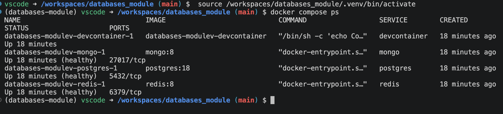

# Exercício 01: Database engines and diagnosis

## Enunciado

Folder: `exercises/01-diagnosis/README.md`

1. A screenshot of `docker compose ps` with the three engines healthy.
2. The data model of your Project I: list of tables and relationships.
3. Three concrete problems in that model (for example duplicated data, a missing constraint, a field that should be a table, a price calculated on read), with the file and line where each one is.
4. What would happen with 100,000 records, or with two users writing at the same time.
5. Would any of the data be better in MongoDB or Redis? Why?

If you do not have a Project I, use booking-lite or, with permission, a colleague's project.

Marked 2 when all five points are answered with examples from the actual code.

## Challenge (opcional, em `challenge/`)

Write a Python script that starts 10 processes, each appending 1,000 records to the same JSON file (read, append, write back). Count how many records end up in the file. Then do the same against a PostgreSQL table with 10 concurrent connections and compare. Explain in a few sentences why the numbers differ.

## Checklist

- [ ] Screenshot of `docker compose ps` with the three engines healthy
- [ ] Data model of Project I: list of tables and relationships
- [ ] Three concrete problems in that model, with file and line for each
- [ ] What would happen with 100,000 records, or two users writing at the same time
- [ ] Would any of the data be better in MongoDB or Redis? Why?

## Resposta

### 1. `docker compose ps`

Os três motores (`postgres:18`, `mongo:8`, `redis:8`) estão `Up (healthy)`. O healthcheck de cada um está definido em [docker-compose.yml](../../docker-compose.yml): `pg_isready`, `db.adminCommand('ping')` e `redis-cli ping`.

### 2. Modelo de dados do Projeto I

Projeto analisado: [sessions/01-database-engines/fastapi](../../sessions/01-database-engines/fastapi/), com o Django e o Next.js da mesma sessão como comparação. A mesma mensagem é gravada nos três motores em `POST /hello` ([main.py:50-73](../../sessions/01-database-engines/fastapi/app/main.py#L50-L73)).

**PostgreSQL**, tabela `hello` ([clients.py:27-31](../../sessions/01-database-engines/fastapi/app/clients.py#L27-L31)):

| Coluna | Tipo | Regras |
|--------|------|--------|
| `id` | `integer GENERATED ALWAYS AS IDENTITY` | PK |
| `msg` | `text` | `NOT NULL` |
| `created_at` | `timestamptz` | `NOT NULL DEFAULT now()` |

**MongoDB**, coleção `hello` ([main.py:61-63](../../sessions/01-database-engines/fastapi/app/main.py#L61-L63)): `{ _id, msg, tags: ["a", "b"], created_at }`

**Redis** ([main.py:66-67](../../sessions/01-database-engines/fastapi/app/main.py#L66-L67)): `hello:last` (string com a última mensagem) e `hello:count` (contador).

Relações: não há nenhuma relação explícita. É uma única tabela, sem FKs. A "relação" entre a linha do PostgreSQL, o documento do MongoDB e as chaves do Redis existe só porque o código as escreve na mesma request. Nenhum dos três guarda o identificador dos outros.

### 3. Três problemas no modelo

| # | Problema | Ficheiro:linha | Porque é um problema |
|---|----------|----------------|----------------------|
| 1 | **Escrita em três motores sem atomicidade nem fonte de verdade.** O `INSERT` no PostgreSQL faz commit ao sair do `with` (linha 58), e só depois se escreve no MongoDB (61) e no Redis (66-67). | [main.py:54-67](../../sessions/01-database-engines/fastapi/app/main.py#L54-L67) | Se o MongoDB ou o Redis falharem, a linha já está no PostgreSQL e os outros não a têm. O `hello:count` passa a ser diferente de `SELECT count(*) FROM hello`, e nada diz qual dos valores está certo. |
| 2 | **Dados duplicados que divergem.** `msg` é guardada três vezes, e `created_at` duas: `now()` do servidor PostgreSQL e `datetime.now(UTC)` do processo Python. O documento do MongoDB não guarda o `id` da linha. | [clients.py:30](../../sessions/01-database-engines/fastapi/app/clients.py#L30), [main.py:62](../../sessions/01-database-engines/fastapi/app/main.py#L62) | A mesma mensagem fica com dois timestamps diferentes. Sem o `id` no documento, não há forma de cruzar ou reconciliar os dois registos. |
| 3 | **Falta uma restrição na base de dados.** `msg` só tem `NOT NULL`. A regra "não vazia" existe apenas na aplicação: `Field(min_length=1)` no FastAPI, `msg.strip()` no Django. | [clients.py:29](../../sessions/01-database-engines/fastapi/app/clients.py#L29), [main.py:21](../../sessions/01-database-engines/fastapi/app/main.py#L21), [models.py:5](../../sessions/01-database-engines/django/demo/models.py#L5) | Um `INSERT` direto, um script ou outra app grava `''` ou `'   '` sem erro. No FastAPI, `"   "` passa a validação, porque `min_length` não faz `strip`. A regra devia ser `CHECK (btrim(msg) <> '')`. Além disso, as `tags` estão fixas em `["a", "b"]` ([main.py:62](../../sessions/01-database-engines/fastapi/app/main.py#L62)), ou seja, são dados inventados e não vêm do pedido. |

### 4. Com 100 000 registos ou dois utilizadores a escrever ao mesmo tempo

**100 000 registos.** As leituras aguentam bem: `ORDER BY id DESC LIMIT 5` ([main.py:81](../../sessions/01-database-engines/fastapi/app/main.py#L81)) usa o índice da PK, e `sort("_id", -1).limit(5)` usa o índice de `_id`. O problema é a ligação. `pg_connect()` abre uma ligação nova ao PostgreSQL em cada request ([clients.py:18-20](../../sessions/01-database-engines/fastapi/app/clients.py#L18-L20)). Cada ligação custa um processo no servidor e um handshake, e o PostgreSQL aceita por omissão 100 ligações (`max_connections`). Com muitos pedidos, a API fica lenta ou recebe `too many clients`, e a solução é um pool. Se alguém acrescentar uma pesquisa por `msg` ou por data, isso passa a ser um *full scan*, porque não há índices além da PK.

**Dois utilizadores ao mesmo tempo.** O `IDENTITY` do PostgreSQL e o `INCR` do Redis são atómicos, por isso nenhum `id` se repete e o contador não perde incrementos. Mas os três passos não são atómicos em conjunto. Por exemplo:

1. A insere no PostgreSQL → `id = 1`
2. B insere no PostgreSQL → `id = 2`
3. B faz `SET hello:last "B"`
4. A faz `SET hello:last "A"`

O resultado é que `hello:last` fica com `"A"`, enquanto a última linha no PostgreSQL é a de B. A "última mensagem" mostrada pelo `GET /hello` ([main.py:91](../../sessions/01-database-engines/fastapi/app/main.py#L91)) contradiz a tabela. Se um dos dois pedidos falhar depois do commit, o contador também deixa de bater certo.

### 5. MongoDB ou Redis?

- **PostgreSQL deve ser a fonte de verdade** para a mensagem (`id`, `msg`, `created_at`). São dados que não se podem perder nem contradizer.
- **Redis** faz sentido para `hello:count` e `hello:last`, mas como dados **derivados**: uma cache que se pode reconstruir a qualquer momento com `SELECT count(*) FROM hello` e `SELECT msg FROM hello ORDER BY id DESC LIMIT 1`. É rápido e serve para um contador muito lido. Mas se o Redis perder dados (o [docker-compose.yml](../../docker-compose.yml) não ativa AOF), o contador volta a 0 e tem de ser reconstruído a partir do PostgreSQL. Para o `last` não ficar errado com escritas concorrentes, deve guardar-se também o `id` (ou usar um sorted set com o `id` como score).
- **MongoDB**: a cópia da mensagem não acrescenta nada, porque é a mesma estrutura fixa. Só faria sentido se as `tags` (ou outros atributos) viessem do utilizador e variassem de forma de documento para documento. Nesse caso o documento devia guardar o `id` do PostgreSQL. Em relacional, as tags exigiriam uma tabela `hello_tag (hello_id FK, tag)`.
