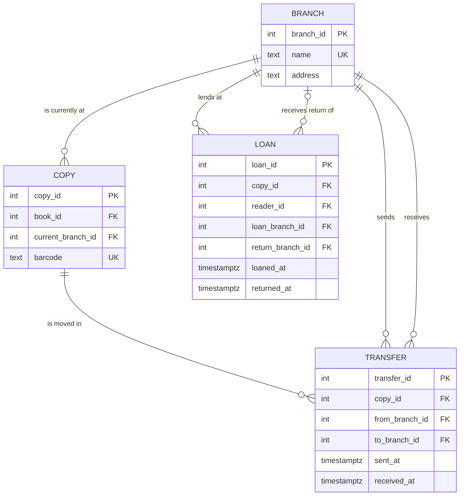

# Challenge 02: Modelling, ER diagrams and normalisation

Opcional.

## Enunciado

The library opens three branches, and copies can be transferred between them. Readers can return a copy at any branch. Extend your model to record where each copy is at any moment and the full history of its transfers. Then find a table in your model that is in 3NF but not in BCNF (Boyce-Codd normal form), or show that none exists, and explain the difference.

## Resposta

Parte do modelo do [model.md](../model.md). Aqui só mostro o que muda.

### Pressupostos

- A biblioteca passa a ter três **bibliotecas** (filiais). Cada exemplar pode estar fisicamente em qualquer uma delas.
- Uma **transferência** leva um exemplar de uma biblioteca para outra. Tem saída e chegada: entre as duas, o exemplar está **em trânsito** e não está em nenhuma biblioteca.
- Um leitor pode levar um exemplar numa biblioteca e devolvê-lo noutra. O exemplar fica na biblioteca onde foi devolvido até ser transferido.
- O histórico nunca se apaga: cada transferência e cada empréstimo ficam registados para sempre.

### Diagrama ER (só as partes novas)



`COPY` e `LOAN` só mostram as colunas novas e as chaves. As restantes colunas são as do [model.md](../model.md).

### Tabelas novas e alteradas

| Tabela | PK | FKs | UNIQUE | Restantes colunas |
|--------|----|-----|--------|-------------------|
| `branch` (nova) | `branch_id` | — | `name` | `address` |
| `transfer` (nova) | `transfer_id` | `copy_id → copy`, `from_branch_id → branch`, `to_branch_id → branch` | — | `sent_at`, `received_at` (vazio enquanto está em trânsito) |
| `loan` (alterada) | `loan_id` | + `loan_branch_id → branch`, + `return_branch_id → branch` (vazio enquanto não for devolvido) | — | igual |
| `copy` (alterada) | `copy_id` | + `current_branch_id → branch` (vazio enquanto está emprestado ou em trânsito) | — | igual |

### Todo o histórico

O histórico são duas tabelas de eventos que nunca se apagam:

- `transfer`: cada viagem entre bibliotecas, com origem, destino, hora de saída e hora de chegada.
- `loan`: cada saída para um leitor (`loan_branch_id`, `loaned_at`) e cada devolução (`return_branch_id`, `returned_at`).

Juntando as duas e ordenando por data, sabe-se onde o exemplar estava em qualquer momento:

```sql
-- Linha temporal do exemplar 42
SELECT 'saiu por transferência' AS evento, from_branch_id AS branch_id, sent_at AS em
FROM transfer WHERE copy_id = 42
UNION ALL
SELECT 'chegou por transferência', to_branch_id, received_at
FROM transfer WHERE copy_id = 42 AND received_at IS NOT NULL
UNION ALL
SELECT 'emprestado', loan_branch_id, loaned_at
FROM loan WHERE copy_id = 42
UNION ALL
SELECT 'devolvido', return_branch_id, returned_at
FROM loan WHERE copy_id = 42 AND returned_at IS NOT NULL
ORDER BY em;
```

### Onde está agora

A posição atual fica guardada em `copy.current_branch_id`. É uma denormalização: o valor podia ser deduzido do evento mais recente das duas tabelas acima, mas isso obriga a juntar `transfer` e `loan` sempre que se pergunta "onde está este exemplar?", e essa pergunta é feita a toda a hora, no balcão e no catálogo online.

O valor é atualizado **na mesma transação** que regista o evento, por isso as duas escritas acontecem juntas ou não acontece nenhuma:

| Evento | Escrita no histórico | `copy.current_branch_id` passa a |
|--------|----------------------|----------------------------------|
| Empréstimo | `INSERT INTO loan` | vazio |
| Devolução | `UPDATE loan SET returned_at, return_branch_id` | `return_branch_id` |
| Saída de transferência | `INSERT INTO transfer` | vazio |
| Chegada de transferência | `UPDATE transfer SET received_at` | `to_branch_id` |

Se alguma vez os dois ficarem diferentes, o histórico é a fonte de verdade e `current_branch_id` pode ser recalculado a partir dele.

### Uma tabela em 3NF mas não em BCNF?

**A diferença.** Numa dependência `X → A` (conhecer `X` determina `A`):

- a **3NF** aceita-a se `X` for superchave, **ou** se `A` fizer parte de alguma chave candidata;
- a **BCNF** só a aceita se `X` for superchave. Não tem a exceção.

Por isso, uma tabela em 3NF só pode falhar a BCNF quando tem **várias chaves candidatas compostas que partilham colunas**.

**No meu modelo não há nenhuma.** Quase todas as tabelas têm uma chave substituta simples (`*_id`), e todas as dependências partem dessa chave ou de uma chave natural `UNIQUE` (`isbn`, `barcode`, `card_number`, `email`, `name`). Todas são superchaves, por isso essas tabelas estão em BCNF.

A única tabela com chaves compostas que se sobrepõem é `book_author`:

- chaves candidatas: `{book_id, author_id}` e `{book_id, author_order}` (num livro, não há dois autores na mesma posição);
- dependências: `{book_id, author_id} → author_order` e `{book_id, author_order} → author_id`.

As duas partem de chaves candidatas, e `author_id` sozinho não determina nada, porque o mesmo autor aparece em posições diferentes em livros diferentes. Por isso `book_author` também está em BCNF.

**Exemplo de uma tabela que falharia.** Suponha-se uma regra nova: "cada leitor tem um bibliotecário de referência em cada biblioteca, e cada bibliotecário trabalha numa só biblioteca". A tabela natural seria:

| reader_id | branch_id | librarian_id |
|-----------|-----------|--------------|
| 1 | Centro | Ana |
| 2 | Centro | Ana |
| 1 | Norte | Rui |

- chaves candidatas: `{reader_id, branch_id}` e `{reader_id, librarian_id}`;
- dependências: `{reader_id, branch_id} → librarian_id` e `librarian_id → branch_id`.

Está em 3NF, porque em `librarian_id → branch_id` o lado direito (`branch_id`) faz parte de uma chave candidata. **Não** está em BCNF, porque `librarian_id` não é superchave. O problema vê-se nos dados: "a Ana trabalha no Centro" está repetido em duas linhas, e se a Ana mudar de biblioteca é preciso alterar todas. A decomposição para BCNF guarda esse facto uma só vez:

- `librarian (librarian_id PK, branch_id FK)`
- `reader_librarian (reader_id, librarian_id)`, com PK `(reader_id, librarian_id)`

O preço é que a regra "um bibliotecário por leitor em cada biblioteca" deixa de poder ser um simples `UNIQUE`, porque `branch_id` já não está na mesma tabela. Por isso, quando passar para BCNF obriga a perder uma restrição, às vezes fica-se deliberadamente pela 3NF.
