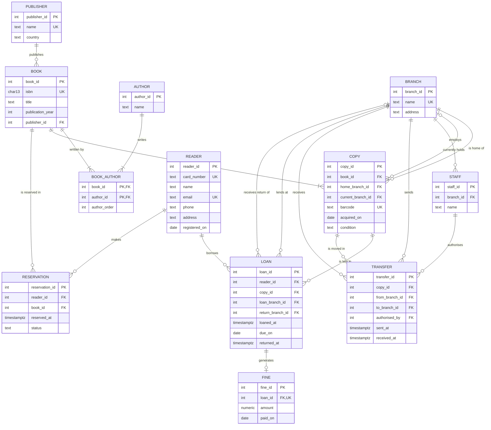

# Challenge 02: Branches, transfers and BCNF

- [x] 1. Extended model: home branch, current location and full transfer history (from, to, date, who authorised it)
- [x] 2. Two plain-language queries and the tables that answer them
- [x] 3. A table in 3NF but not in BCNF, or proof that none exists, with the functional dependencies

Parte do modelo do [exercise/model.md](../exercise/model.md). As tabelas que não aparecem em "Tabelas novas e alteradas" ficam iguais.

## Pressupostos

- A biblioteca passa a ter três **bibliotecas** (filiais).
- Cada exemplar tem uma **biblioteca de origem** (`home_branch_id`), a que o comprou e a que pertence. Não muda com as transferências.
- Uma **transferência** leva um exemplar de uma biblioteca para outra e é autorizada por um **funcionário**. Tem saída e chegada: entre as duas, o exemplar está **em trânsito** e não está em nenhuma biblioteca.
- Cada funcionário trabalha numa só biblioteca.
- Um leitor pode levar um exemplar numa biblioteca e devolvê-lo noutra. O exemplar fica na biblioteca onde foi devolvido até alguém o transferir (por exemplo, de volta para a biblioteca de origem).
- O histórico nunca se apaga: cada transferência e cada empréstimo ficam registados para sempre.

## 1. Diagrama ER estendido



## Tabelas novas e alteradas

| Tabela | PK | FKs | UNIQUE | Restantes colunas |
|--------|----|-----|--------|-------------------|
| `branch` (nova) | `branch_id` | — | `name` | `address` |
| `staff` (nova) | `staff_id` | `branch_id → branch` | — | `name` |
| `transfer` (nova) | `transfer_id` | `copy_id → copy`, `from_branch_id → branch`, `to_branch_id → branch`, `authorised_by → staff` | — | `sent_at`, `received_at` (vazio enquanto está em trânsito) |
| `copy` (alterada) | `copy_id` | + `home_branch_id → branch` (obrigatória), + `current_branch_id → branch` (vazia enquanto está emprestado ou em trânsito) | `barcode` | igual |
| `loan` (alterada) | `loan_id` | + `loan_branch_id → branch` (obrigatória), + `return_branch_id → branch` (vazia até à devolução) | — | igual |

Regras novas que a estrutura sozinha não garante:

| Regra | Onde | Como |
|-------|------|------|
| Uma transferência vai para uma biblioteca diferente | constraint | `CHECK (from_branch_id <> to_branch_id)` |
| A chegada não é antes da saída | constraint | `CHECK (received_at IS NULL OR received_at >= sent_at)` |
| Um exemplar está no máximo numa transferência em curso | constraint | índice único parcial: `UNIQUE (copy_id) WHERE received_at IS NULL` |
| Só se transfere um exemplar a partir de onde ele está, e não enquanto está emprestado | trigger | `BEFORE INSERT ON transfer`: rejeita se `from_branch_id IS DISTINCT FROM copy.current_branch_id`. Um exemplar emprestado ou em trânsito tem `current_branch_id` vazio, por isso também é rejeitado (com `<>`, a comparação com vazio dava `NULL` e o trigger deixava passar). |
| Só se empresta um exemplar na biblioteca onde ele está | trigger | `BEFORE INSERT ON loan`: rejeita se `loan_branch_id IS DISTINCT FROM copy.current_branch_id`, pelo mesmo motivo |
| A data limite de um empréstimo é guardada, não calculada | — | Igual ao exercício: `due_on` é um facto do empréstimo (ver [exercise/model.md](../exercise/model.md), secções 2 e 4) |
| `copy.current_branch_id` acompanha o histórico | trigger ou aplicação | ver "Onde está agora" |

## Todo o histórico

O histórico são duas tabelas de eventos que nunca se apagam:

- `transfer`: cada viagem entre bibliotecas, com origem, destino, hora de saída, hora de chegada e quem a autorizou.
- `loan`: cada saída para um leitor (`loan_branch_id`, `loaned_at`) e cada devolução (`return_branch_id`, `returned_at`).

Juntando as duas e ordenando por data, sabe-se onde o exemplar estava em qualquer momento:

```sql
-- Linha temporal do exemplar 42
SELECT 'saiu por transferência' AS evento, from_branch_id AS branch_id, sent_at AS em
FROM transfer WHERE copy_id = 42
UNION ALL
SELECT 'chegou por transferência', to_branch_id, received_at
FROM transfer WHERE copy_id = 42 AND received_at IS NOT NULL
UNION ALL
SELECT 'emprestado', loan_branch_id, loaned_at
FROM loan WHERE copy_id = 42
UNION ALL
SELECT 'devolvido', return_branch_id, returned_at
FROM loan WHERE copy_id = 42 AND returned_at IS NOT NULL
ORDER BY em;
```

## Onde está agora

A posição atual fica guardada em `copy.current_branch_id`, por isso **não é preciso ler o histórico** para a saber. É uma denormalização: o valor podia ser deduzido do evento mais recente das duas tabelas acima, mas isso obriga a juntar `transfer` e `loan` e a ordenar todo o histórico do exemplar sempre que se pergunta "onde está?". Essa pergunta é feita a toda a hora, no balcão e no catálogo online.

O valor é atualizado **na mesma transação** que regista o evento (por um trigger em `loan` e em `transfer`, ou pela aplicação). Assim, as duas escritas acontecem juntas ou não acontece nenhuma:

| Evento | Escrita no histórico | `copy.current_branch_id` passa a |
|--------|----------------------|----------------------------------|
| Empréstimo | `INSERT INTO loan` | vazio |
| Devolução | `UPDATE loan SET returned_at, return_branch_id` | `return_branch_id` |
| Saída de transferência | `INSERT INTO transfer` | vazio |
| Chegada de transferência | `UPDATE transfer SET received_at` | `to_branch_id` |

Se alguma vez os dois ficarem diferentes, o histórico é a fonte de verdade e `current_branch_id` pode ser recalculado a partir dele.

## 2. Perguntas que o modelo tem de responder

### "Onde está o exemplar X agora?"

**Tabelas:** `copy` (e `branch` para o nome). Quando `current_branch_id` está vazio, o exemplar está fora de uma biblioteca, e o único registo aberto em `loan` ou em `transfer` diz onde: com um leitor, ou em trânsito entre duas bibliotecas. Os índices únicos parciais garantem que há no máximo um de cada, e os triggers garantem que não há os dois ao mesmo tempo.

```sql
SELECT c.barcode,
       CASE
           WHEN c.current_branch_id IS NOT NULL THEN 'na biblioteca ' || b.name
           WHEN l.loan_id IS NOT NULL THEN 'emprestado ao leitor ' || l.reader_id || ' até ' || l.due_on
           WHEN t.transfer_id IS NOT NULL THEN 'em trânsito para ' || bt.name
       END AS onde_esta
FROM copy c
LEFT JOIN branch b   ON b.branch_id = c.current_branch_id
LEFT JOIN loan l     ON l.copy_id = c.copy_id AND l.returned_at IS NULL
LEFT JOIN transfer t ON t.copy_id = c.copy_id AND t.received_at IS NULL
LEFT JOIN branch bt  ON bt.branch_id = t.to_branch_id
WHERE c.barcode = 'X';
```

Lê no máximo uma linha de cada tabela, por mais longo que seja o histórico do exemplar.

### "Que exemplares saíram da biblioteca Y no mês passado, e quem autorizou cada saída?"

**Tabelas:** `transfer` (origem e data de saída), `copy` e `book` (que exemplar e que livro), `branch` (destino) e `staff` (quem autorizou).

```sql
SELECT c.barcode, bk.title, dest.name AS para, t.sent_at, s.name AS autorizado_por
FROM transfer t
JOIN branch orig ON orig.branch_id = t.from_branch_id
JOIN branch dest ON dest.branch_id = t.to_branch_id
JOIN copy c      ON c.copy_id = t.copy_id
JOIN book bk     ON bk.book_id = c.book_id
JOIN staff s     ON s.staff_id = t.authorised_by
WHERE orig.name = 'Y'
  AND t.sent_at >= date_trunc('month', now()) - interval '1 month'
  AND t.sent_at <  date_trunc('month', now())
ORDER BY t.sent_at;
```

Se "saíram" também incluir os empréstimos feitos nessa biblioteca, junta-se com `UNION ALL` uma consulta igual sobre `loan`, filtrada por `loan_branch_id` e `loaned_at`.

Com o mesmo modelo responde-se ainda a "que exemplares estão fora da sua biblioteca de origem?", com `copy` apenas: `WHERE current_branch_id <> home_branch_id`.

## 3. Uma tabela em 3NF mas não em BCNF?

**A diferença.** Numa dependência funcional `X → A` (conhecer `X` determina `A`):

- a **3NF** aceita-a se `X` for superchave, **ou** se `A` fizer parte de alguma chave candidata;
- a **BCNF** só a aceita se `X` for superchave. Não tem a exceção.

Por isso, uma tabela em 3NF só pode falhar a BCNF quando tem **várias chaves candidatas compostas que partilham colunas**.

**No meu modelo não há nenhuma.** Estas são as dependências funcionais de cada tabela (as triviais ficam de fora):

| Tabela | Chaves candidatas | Dependências funcionais |
|--------|-------------------|-------------------------|
| `publisher` | `{publisher_id}`, `{name}` | `publisher_id → name, country`; `name → publisher_id, country` |
| `author` | `{author_id}` | `author_id → name` |
| `book` | `{book_id}`, `{isbn}` | `book_id → isbn, title, publication_year, publisher_id`; `isbn → book_id, ...` |
| `book_author` | `{book_id, author_id}`, `{book_id, author_order}` | `{book_id, author_id} → author_order`; `{book_id, author_order} → author_id` |
| `branch` | `{branch_id}`, `{name}` | `branch_id → name, address`; `name → branch_id, address` |
| `staff` | `{staff_id}` | `staff_id → branch_id, name` |
| `copy` | `{copy_id}`, `{barcode}` | `copy_id → book_id, home_branch_id, current_branch_id, barcode, acquired_on, condition`; `barcode → copy_id, ...` |
| `transfer` | `{transfer_id}` | `transfer_id → copy_id, from_branch_id, to_branch_id, authorised_by, sent_at, received_at` |
| `reader` | `{reader_id}`, `{card_number}`, `{email}` | cada uma das três determina todas as outras colunas |
| `loan` | `{loan_id}` | `loan_id → reader_id, copy_id, loan_branch_id, return_branch_id, loaned_at, due_on, returned_at` |
| `reservation` | `{reservation_id}` | `reservation_id → reader_id, book_id, reserved_at, status` |
| `fine` | `{fine_id}`, `{loan_id}` | `fine_id → loan_id, amount, paid_on`; `loan_id → fine_id, amount, paid_on` |

Em todas as linhas, o lado esquerdo de cada dependência é uma chave candidata, por isso é superchave e todas as tabelas estão em BCNF.

Não incluo `loaned_at → due_on` em `loan`: os 14 dias são o prazo em vigor quando o empréstimo é feito, e um empréstimo feito antes de uma mudança de regulamento mantém a data antiga. Como a regra não vale para todas as linhas, não é uma dependência funcional da tabela.

Dois casos merecem atenção:

- **`book_author`** é a única tabela com chaves compostas que se sobrepõem (partilham `book_id`). Mesmo assim está em BCNF, porque as duas dependências partem de chaves candidatas, e `author_id` sozinho não determina nada: o mesmo autor aparece em posições diferentes em livros diferentes.
- **`transfer`** tem a dependência `authorised_by → branch do funcionário`, mas essa biblioteca **não** está guardada em `transfer`: fica em `staff`. Se eu guardasse `transfer.staff_branch_id`, haveria uma dependência transitiva (`transfer_id → authorised_by → staff_branch_id`) e a tabela já nem estaria em 3NF.

**Exemplo de uma tabela que falharia.** Suponha-se uma regra nova: "cada leitor tem um funcionário de referência em cada biblioteca, e cada funcionário trabalha numa só biblioteca". A tabela natural seria:

| reader_id | branch_id | staff_id |
|-----------|-----------|----------|
| 1 | Centro | Ana |
| 2 | Centro | Ana |
| 1 | Norte | Rui |

- chaves candidatas: `{reader_id, branch_id}` e `{reader_id, staff_id}`;
- dependências: `{reader_id, branch_id} → staff_id` e `staff_id → branch_id`.

Está em 3NF, porque em `staff_id → branch_id` o lado direito (`branch_id`) faz parte de uma chave candidata. **Não** está em BCNF, porque `staff_id` não é superchave. O problema vê-se nos dados: "a Ana trabalha no Centro" está repetido em duas linhas, e se a Ana mudar de biblioteca é preciso alterar todas. A decomposição para BCNF guarda esse facto uma só vez, e é exatamente o que o meu modelo já faz:

- `staff (staff_id PK, branch_id FK, ...)`
- `reader_staff (reader_id, staff_id)`, com PK `(reader_id, staff_id)`

O preço é que a regra "um funcionário de referência por leitor em cada biblioteca" deixa de poder ser um simples `UNIQUE`, porque `branch_id` já não está na mesma tabela e passa a precisar de um trigger. Por isso, quando passar para BCNF obriga a perder uma restrição, às vezes fica-se deliberadamente pela 3NF.
