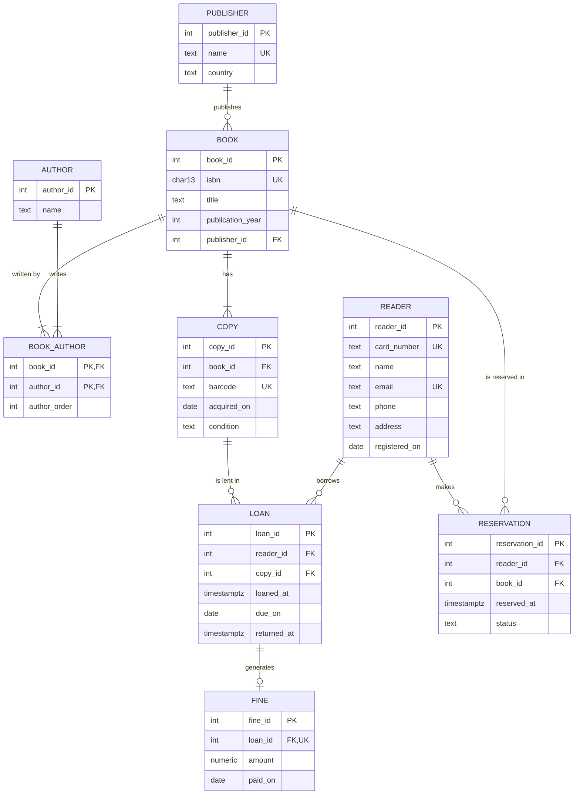

# Exercise 02: Municipal library model

- [x] 1. ER diagram in Mermaid, with attributes, PKs, FKs and cardinalities
- [x] 2. Tables in 3NF, with columns, PK, FKs and `UNIQUE` columns
- [x] 3. Business rules the table structure cannot enforce, and where to enforce each one
- [x] 4. One denormalisation and why

## Pressupostos

Parto dos requisitos do enunciado. Onde não dizem tudo, decidi assim:

- Um **livro** é a obra, identificada pelo ISBN-13. Um **exemplar** é o objeto físico na prateleira, identificado pelo código de barras.
- A ordem dos autores de um livro guarda-se na tabela de associação `book_author`, na coluna `author_order` (1 = primeiro autor).
- O requisito não diz que dados tem um **autor**: guardo só o nome.
- Uma **reserva** é feita sobre um livro, não sobre um exemplar. A ordem de atendimento é a ordem de `reserved_at`.
- Uma **multa** só nasce de uma devolução atrasada, por isso cada empréstimo tem no máximo uma multa.
- Todas as tabelas usam uma chave substituta (`*_id`, gerada pela base de dados). As chaves naturais (`isbn`, `barcode`, `card_number`, `email`, nome da editora) ficam como `UNIQUE`.

## 1. ER diagram

Cardinalidades:

| Relação | Cardinalidade | Porquê |
|---------|---------------|--------|
| editora – livro | 1 : 0..N | Cada livro tem exatamente uma editora. |
| livro – autor | N : N, via `book_author` | Um livro tem 1 ou mais autores, um autor escreve vários livros. |
| livro – exemplar | 1 : 1..N | A biblioteca tem um ou mais exemplares de cada livro. |
| exemplar – empréstimo | 1 : 0..N | Ao longo do tempo, o mesmo exemplar é emprestado muitas vezes. |
| leitor – empréstimo | 1 : 0..N | |
| empréstimo – multa | 1 : 0..1 | Só há multa se a devolução for atrasada. Cada multa é de um só empréstimo. |
| leitor – reserva | 1 : 0..N | |
| livro – reserva | 1 : 0..N | |

## 2. Tables (3NF)

| Tabela | PK | FKs | UNIQUE | Restantes colunas |
|--------|----|-----|--------|-------------------|
| `publisher` | `publisher_id` | — | `name` | `country` |
| `author` | `author_id` | — | — | `name` |
| `book` | `book_id` | `publisher_id → publisher` (obrigatória) | `isbn` | `title`, `publication_year` |
| `book_author` | `(book_id, author_id)` | `book_id → book`, `author_id → author` | `(book_id, author_order)` | `author_order` |
| `copy` | `copy_id` | `book_id → book` | `barcode` | `acquired_on`, `condition` |
| `reader` | `reader_id` | — | `card_number`, `email` | `name`, `phone`, `address`, `registered_on` |
| `loan` | `loan_id` | `reader_id → reader`, `copy_id → copy` | — | `loaned_at`, `due_on`, `returned_at` (vazio até à devolução) |
| `reservation` | `reservation_id` | `reader_id → reader`, `book_id → book` | — | `reserved_at`, `status` |
| `fine` | `fine_id` | `loan_id → loan` | `loan_id` | `amount`, `paid_on` (vazio até ao pagamento) |

`UNIQUE (book_id, author_order)` em `book_author` impede dois autores na mesma posição do mesmo livro. `UNIQUE (loan_id)` em `fine` garante no máximo uma multa por empréstimo.

Porque estão em 3NF:

- **1NF**: cada coluna guarda um só valor. Os autores de um livro não ficam numa lista dentro de `book`: cada par livro–autor é uma linha de `book_author`.
- **2NF**: a única tabela com chave primária composta é `book_author`, e a sua coluna não-chave, `author_order`, depende do par (livro, autor) inteiro. O mesmo autor pode ser o 1º num livro e o 2º noutro.
- **3NF**: nenhuma coluna não-chave depende de outra coluna não-chave. Por exemplo:
  - O título, o ano e a editora são factos sobre o livro, não sobre o exemplar. Ficam em `book` e não se repetem em cada exemplar.
  - O país da editora fica em `publisher`. Se estivesse em `book`, dependeria de `publisher_id` e não do livro (dependência transitiva `book → publisher → country`).
  - `fine` não guarda `reader_id`, porque o leitor já se obtém pelo empréstimo (`fine → loan → reader`).
  - O estado "emprestado / disponível" de um exemplar não é guardado em `copy`: deduz-se de haver ou não um `loan` desse exemplar com `returned_at` vazio.
  - `loan.due_on` parece depender de `loaned_at` (mais 14 dias), o que seria uma dependência entre colunas não-chave. Não é: os 14 dias são o prazo do regulamento **no momento do empréstimo**, não uma regra fixa. Se o prazo mudar, os empréstimos antigos mantêm a sua data limite, por isso `loaned_at` não determina `due_on` para todas as linhas da tabela. `due_on` é um facto do empréstimo, e depende só de `loan_id` (ver secções 3 e 4).

## 3. Regras que a estrutura das tabelas não garante

As PKs, FKs, `UNIQUE` e `NOT NULL` acima já garantem, por exemplo, que um livro tem exatamente uma editora, que um ISBN não se repete e que uma multa é de um só empréstimo. Estas regras precisam de mais:

| Regra | Onde | Como |
|-------|------|------|
| O ISBN tem 13 dígitos | constraint | `CHECK (isbn ~ '^[0-9]{13}$')` |
| `condition` só pode ser `new`, `good`, `worn` ou `damaged` | constraint | `CHECK (condition IN (...))` |
| `status` da reserva só pode ser `active`, `fulfilled` ou `cancelled` | constraint | `CHECK (status IN (...))` |
| A data limite é 14 dias depois do empréstimo | trigger ou aplicação | Preenchida ao inserir: `BEFORE INSERT ON loan` faz `due_on := loaned_at::date + 14` se vier vazia (um `DEFAULT` não pode usar outra coluna). Não uso `CHECK (due_on = ...)`, porque isso tornava `due_on` uma cópia de `loaned_at` e impedia mudar o prazo no futuro (ver secção 4). Fica só `CHECK (due_on > loaned_at::date)`. |
| A devolução não pode ser antes do empréstimo | constraint | `CHECK (returned_at IS NULL OR returned_at >= loaned_at)` |
| Um exemplar está no máximo num empréstimo aberto | constraint | índice único parcial: `UNIQUE (copy_id) WHERE returned_at IS NULL` |
| Um leitor tem no máximo 5 empréstimos abertos | trigger | `BEFORE INSERT ON loan`: conta os empréstimos com `returned_at IS NULL` desse leitor e rejeita o sexto. Tem de bloquear a linha do leitor (`SELECT ... FOR UPDATE`), senão dois empréstimos em simultâneo passam os dois. |
| Um livro tem pelo menos um autor | trigger ou aplicação | Uma FK não obriga a existir uma linha em `book_author`. Na aplicação: o livro e os seus autores são inseridos na mesma transação. Na base de dados: constraint trigger `DEFERRABLE INITIALLY DEFERRED`, verificado no `COMMIT`. |
| A biblioteca tem pelo menos um exemplar de cada livro | aplicação | Mesmo problema: o livro e o primeiro exemplar são registados na mesma transação. |
| Só se reserva um livro quando nenhum exemplar está disponível | trigger | `BEFORE INSERT ON reservation`: rejeita se houver um exemplar desse livro sem empréstimo aberto. |
| As reservas do mesmo livro são atendidas por ordem | aplicação | Quando um exemplar é devolvido, a aplicação escolhe a reserva `active` desse livro com o `reserved_at` mais antigo e passa-a a `fulfilled`. |
| Uma devolução atrasada cria uma multa de 0,50 por dia de atraso | trigger | `AFTER UPDATE OF returned_at ON loan`: se `returned_at::date > due_on`, insere em `fine` o valor `0.50 * (returned_at::date - due_on)`. Também se garante `CHECK (amount > 0)` em `fine`. |
| O pagamento da multa não pode ser antes da devolução | trigger | `paid_on` e `returned_at` estão em tabelas diferentes, por isso um `CHECK` não chega. |

Prefiro constraints sempre que possível, porque valem para qualquer cliente que escreva na base de dados. Uso triggers quando a regra precisa de ler outras linhas, e a aplicação quando a regra é sobre o fluxo de trabalho (que reserva atender a seguir).

## 4. Denormalisation

**Guardar o valor da multa (`fine.amount`) em vez de o calcular sempre que é lido.**

O valor podia ser calculado a partir do empréstimo: `0,50 × (returned_at − due_on)`. Guardá-lo é, por isso, uma redundância. Mesmo assim guardo-o, por uma razão de **histórico**: o valor por dia é uma regra do regulamento da biblioteca e pode mudar. Uma multa emitida a 0,50 por dia tem de continuar a valer o mesmo depois de o regulamento passar a 1,00 por dia, sobretudo se já foi paga. Se fosse recalculada sempre que é lida, uma mudança de preço alterava as multas antigas.

O custo é pequeno: o valor é escrito uma vez, quando a multa é criada, e nunca mais muda. Também não fica dessincronizado, porque `returned_at` e `due_on` também não mudam depois da devolução.

Pela mesma razão, `loan.due_on` é guardado e não calculado como `loaned_at + 14` sempre que é lido: se o prazo passar a 21 dias, os empréstimos já feitos continuam a vencer na data que foi combinada com o leitor.

**O que não denormalizo:** o estado do exemplar (`copy.status = 'emprestado'`). Seria mais rápido de ler, mas teria de ser atualizado em cada empréstimo e em cada devolução, e se uma dessas atualizações falhasse ficava a contradizer a tabela `loan`. Saber se um exemplar está disponível já se responde procurando um `loan` desse exemplar com `returned_at` vazio, e o índice único parcial da secção 3 torna essa procura rápida.
