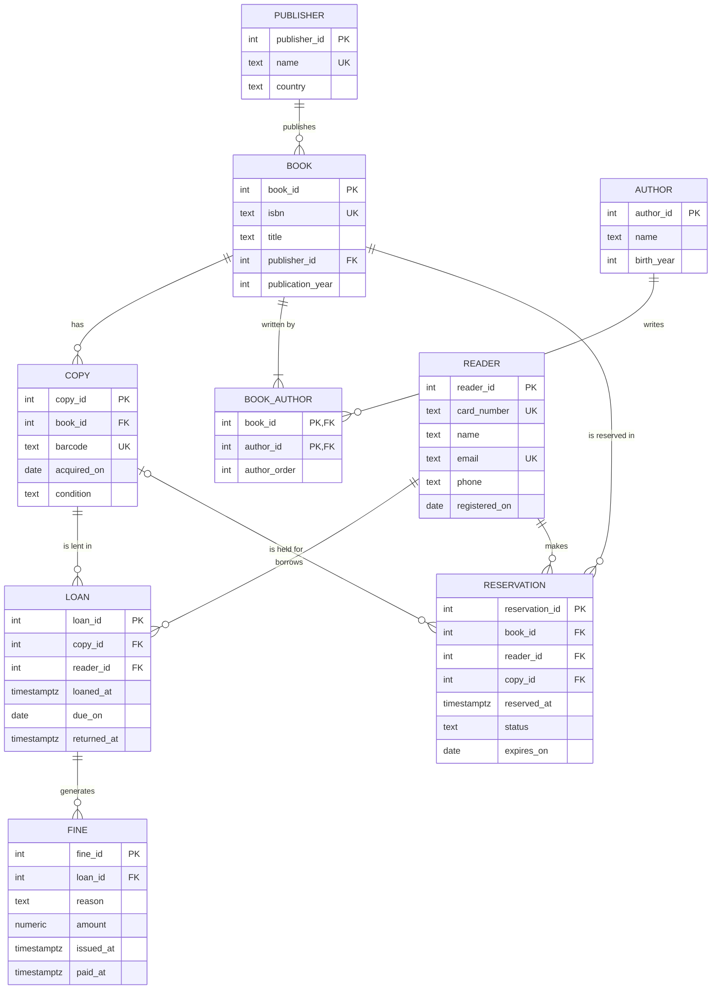

# Exercise 02: Municipal library model

- [x] ER diagram in Mermaid, with cardinalities
- [x] List of tables in 3NF, with primary and foreign keys
- [x] One denormalisation you would make and why (or why none)

## Pressupostos

Não há ficheiro de requisitos na pasta, por isso parto das entidades do enunciado (leitores, livros, exemplares, autores, editoras, empréstimos, reservas e multas) e destas regras:

- Um **livro** é a obra, identificada pelo ISBN. Um **exemplar** é o objeto físico na prateleira, identificado por um código de barras. Um livro tem 0 ou mais exemplares, e cada exemplar é de um só livro.
- Um livro tem 1 ou mais **autores**, e um autor pode ter escrito vários livros. A ordem dos autores na capa importa.
- Cada livro tem uma **editora**, e uma editora publica vários livros.
- Um **leitor** é identificado pelo número do cartão de leitor. O email também não se pode repetir.
- Um **empréstimo** é de um exemplar concreto a um leitor. Tem data de saída, data limite e data de devolução, que fica vazia enquanto o exemplar não for devolvido.
- Uma **reserva** é feita sobre um livro, não sobre um exemplar: qualquer exemplar serve. Quando um exemplar fica disponível, é guardado para essa reserva.
- Uma **multa** nasce de um empréstimo (atraso, dano ou perda). Um empréstimo pode ter 0 ou mais multas. O leitor da multa é o leitor do empréstimo.

## ER diagram

## Tables (3NF)

Todas as tabelas usam uma chave substituta (`*_id`, gerada pela base de dados). As chaves naturais ficam como `UNIQUE`.

| Tabela | PK | FKs | UNIQUE | Restantes colunas |
|--------|----|-----|--------|-------------------|
| `publisher` | `publisher_id` | — | `name` | `country` |
| `author` | `author_id` | — | — | `name`, `birth_year` |
| `book` | `book_id` | `publisher_id → publisher` | `isbn` | `title`, `publication_year` |
| `book_author` | `(book_id, author_id)` | `book_id → book`, `author_id → author` | `(book_id, author_order)` | `author_order` |
| `copy` | `copy_id` | `book_id → book` | `barcode` | `acquired_on`, `condition` |
| `reader` | `reader_id` | — | `card_number`, `email` | `name`, `phone`, `registered_on` |
| `loan` | `loan_id` | `copy_id → copy`, `reader_id → reader` | — | `loaned_at`, `due_on`, `returned_at` |
| `reservation` | `reservation_id` | `book_id → book`, `reader_id → reader`, `copy_id → copy` (pode ser vazio) | — | `reserved_at`, `status`, `expires_on` |
| `fine` | `fine_id` | `loan_id → loan` | — | `reason`, `amount`, `issued_at`, `paid_at` |

Porque estão em 3NF:

- **1NF**: cada coluna guarda um só valor. Os autores de um livro não ficam numa lista dentro de `book`: cada par livro–autor é uma linha de `book_author`. Uma reserva é de um só livro, por isso cada reserva tem um só `status`.
- **2NF**: a única tabela com chave composta é `book_author`, e a sua única coluna não-chave, `author_order`, depende do par (livro, autor) inteiro. O mesmo autor pode ser 1º num livro e 2º noutro.
- **3NF**: nenhuma coluna não-chave depende de outra coluna não-chave. Por exemplo:
  - O título e a editora são factos sobre o livro, não sobre o exemplar. Ficam em `book` e não se repetem por cada cópia.
  - O país da editora fica em `publisher`. Se estivesse em `book`, dependeria de `publisher_id` e não do livro (dependência transitiva `book → publisher → country`).
  - `fine` não guarda `reader_id`, porque o leitor já se obtém pelo empréstimo (`fine → loan → reader`). Guardá-lo seria repetir o mesmo facto.
  - O estado "emprestado / disponível" de um exemplar não é guardado em `copy`: deduz-se de haver ou não um `loan` desse exemplar com `returned_at` vazio.

## Denormalisation

**Guardar o valor da multa (`fine.amount`) em vez de o calcular sempre que é lido.**

Uma multa por atraso podia ser calculada a partir do empréstimo: dias de atraso (`returned_at − due_on`) × valor por dia. Guardar o resultado é, por isso, uma redundância. Mesmo assim guardo-o, por uma razão de **histórico**: o valor por dia muda quando o regulamento da biblioteca é revisto, e uma multa emitida em 2025 tem de continuar a valer o que valia em 2025. Se fosse recalculada sempre que é lida, uma mudança de preço alterava as multas antigas, incluindo as que já foram pagas. Além disso, as multas por dano ou perda não se conseguem calcular a partir de outros dados.

O custo é pequeno: o valor é escrito uma vez, quando a multa é emitida, e nunca mais é alterado. Não há risco de ficar dessincronizado.

**O que não denormalizo:** o estado do exemplar (`copy.status = 'emprestado'`). Seria mais rápido de ler, mas teria de ser atualizado em cada empréstimo e em cada devolução, e se uma dessas atualizações falhasse ficava a contradizer a tabela `loan`. Saber se um exemplar está disponível já se responde procurando um `loan` desse exemplar com `returned_at` vazio.
