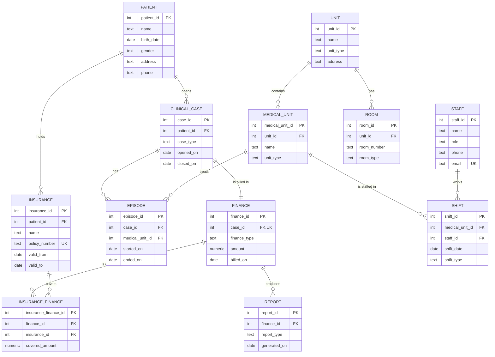

`CASE` é uma palavra reservada do SQL, por isso a entidade chama-se `CLINICAL_CASE`.

Regras que o diagrama não consegue mostrar (estão no [hospital.sql](hospital.sql)):

- `ROOM`: `UNIQUE (unit_id, room_number)`. O número da sala só se pode repetir em unidades diferentes.
- `INSURANCE_FINANCE`: `UNIQUE (finance_id, insurance_id)`. O mesmo seguro não cobre duas vezes a mesma fatura.
- `PATIENT`: `CHECK (gender IN ('M', 'F'))`.
